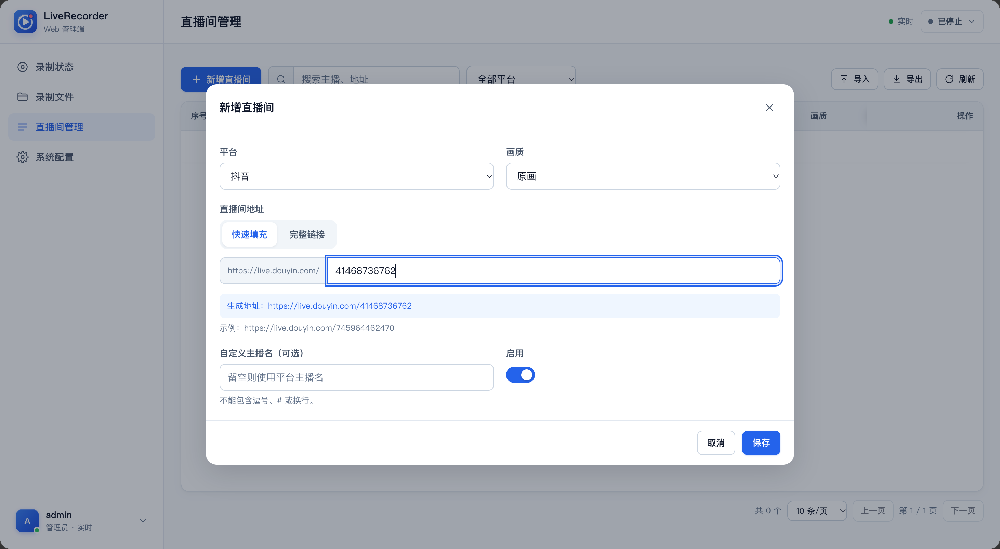
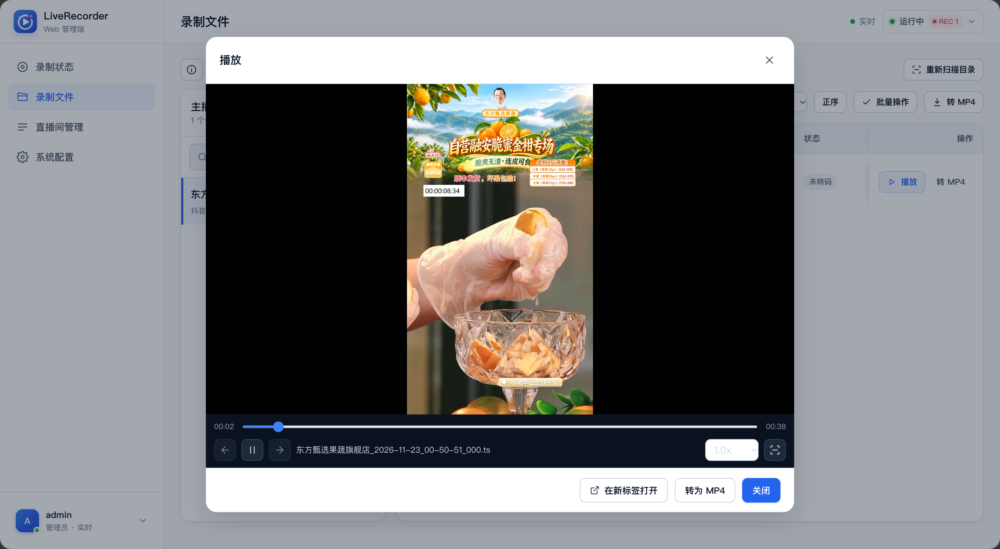
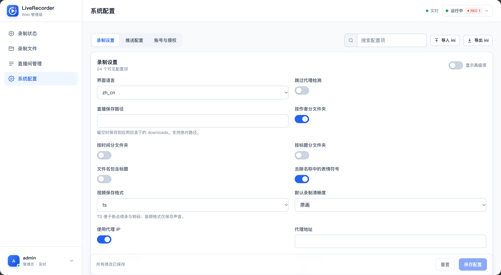
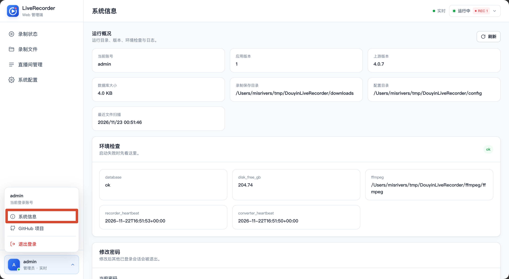
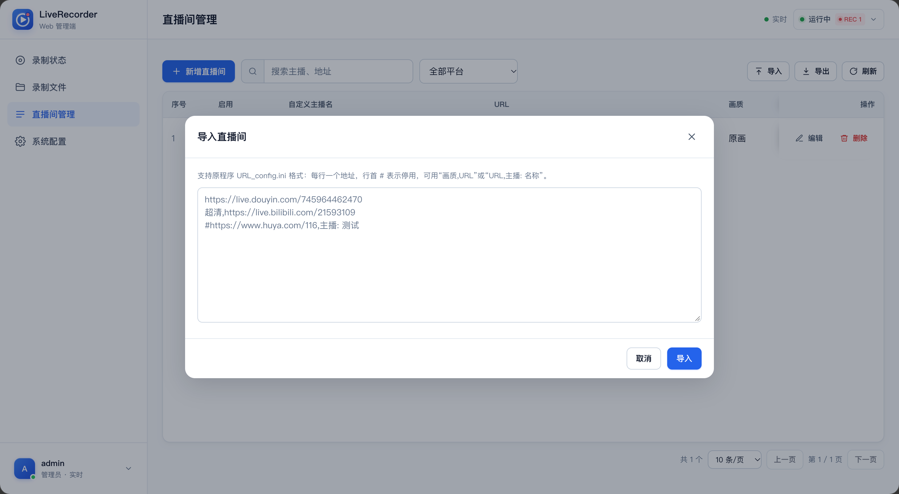
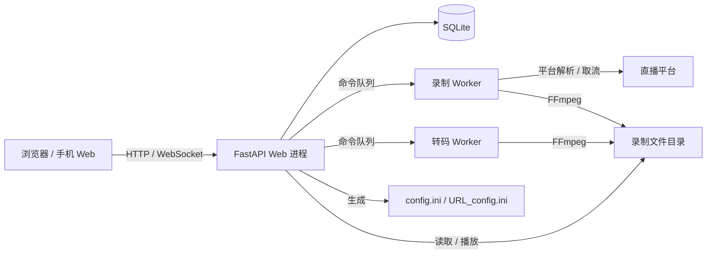

# LiveRecorder Web UI

GitHub 仓库：<https://github.com/MisRivers/DouyinLiveRecorder>

一个面向自托管场景的直播录制管理端，基于 [ihmily/DouyinLiveRecorder](https://github.com/ihmily/DouyinLiveRecorder) 改造而来。它把原本依赖命令行、配置文件和循环值守的录制工具，变成可直接在浏览器和手机端使用的管理系统。

> 本项目是非官方改造版本，与上游项目及抖音官方均无隶属关系。请仅录制你有权录制的内容，并遵守所在平台的服务条款与当地法律法规。

## 目录

- [项目由来](#项目由来)
- [界面预览](#界面预览)
- [功能概览](#功能概览)
- [技术栈](#技术栈)
- [系统架构](#系统架构)
- [目录结构](#目录结构)
- [快速开始](#快速开始)
- [使用说明](#使用说明)
- [配置项](#配置项)
- [Docker 部署](#docker-部署)
- [Windows EXE](#windows-exe)
- [数据与安全](#数据与安全)
- [常见问题](#常见问题)
- [路线图](#路线图)
- [上游与许可](#上游与许可)

## 项目由来

上游 DouyinLiveRecorder 是一个成熟的 Python 直播录制工具，长期通过 `config.ini`、`URL_config.ini` 和命令行运行。实际长期值守时，会遇到几个问题：

- 查看录制状态、修改直播间、检查文件都需要登录服务器或编辑配置文件；
- 缺少直播间增删改查、录制文件浏览、播放、TS 转 MP4 的统一入口；
- 多平台 Cookie、账号、推送配置分散，修改后不容易确认是否生效；
- 手机端无法方便地查看录制状态和处理异常；
- 部署到 NAS 时，命令行、权限、FFmpeg 路径等门槛较高。

LiveRecorder Web UI 在保留上游平台解析与 FFmpeg 录制能力的基础上，增加了：

- Vue 3 单页管理端，桌面端与手机端自适应；
- FastAPI 后端与 SQLite 运行期数据；
- 录制进程、转码进程与 Web 进程分离；
- 直播间、录制文件、系统配置、运行状态的可视化管理；
- 多架构 Docker 镜像，NAS 可直接拉取；
- 兼容上游 `config.ini` / `URL_config.ini` 的导入与生成。

## 界面预览

以下截图来自实际运行的管理端，桌面端浏览器宽度 1024px。

| 初始化管理员 | 录制状态 |
| --- | --- |
|  |  |

| 新增直播间 | 录制进行中 |
| --- | --- |
|  |  |

| 直播间管理 | 录制文件播放 |
| --- | --- |
|  |  |

| 系统配置 | 系统信息 |
| --- | --- |
|  |  |

| 导入直播间 | |
| --- | --- |
|  | |

## 功能概览

### 录制状态

- 正在录制、等待直播、启用直播间、录制程序状态四张摘要卡；
- 录制卡片显示主播、平台、画质、标题、已录制时长、文件大小、当前文件；
- 录制控制迁移到顶部导航，任意页面都可以查看状态并启动、停止、重启；
- 停止时区分优雅停止与强制停止，优雅停止会把 TS 加入转码队列；
- WebSocket 实时刷新，断线时自动回退轮询；
- 直播信号中断时自动重连，30 秒内恢复会继续本次录制。

### 直播间管理

- 新增、编辑、删除、启用/停用直播间；
- 支持快速填充平台 ID 或填写完整直播间地址；
- 支持批量导入、导出上游 `URL_config.ini` 格式；
- 支持搜索、平台筛选、分页，每页条数写入浏览器缓存；
- 从录制卡片点击“前往直播间管理”会定位到对应主播所在页，目标行黄色闪烁并显示“已定位”；
- 停用正在录制的直播间会二次确认，优雅结束当前文件并转 MP4。

### 录制文件

- 按主播分组浏览录制文件；
- 显示文件名、类型、大小、修改时间、转码状态；
- 支持按名称、修改时间、类型排序，排序写入浏览器缓存；
- 支持右键删除、批量勾选删除、批量转码；
- 内置播放器支持 MP4、M4A、MP3、FLV、TS；
- TS 使用 mpegts.js 播放，MP4 使用 HTML5 视频和统一自定义控制条；
- 支持在新标签页打开播放，新标签接管后自动关闭当前弹窗，避免两处同时播放；
- 播放弹窗自适应手机端，音量控制已移除以简化控制条。

### 系统配置

- 录制设置、推送配置、账号与授权、Cookie 管理四个分类；
- 配置项由元数据驱动，未知配置自动归入“上游新增”；
- 布尔、枚举、整数、浮点、多行文本、敏感值分别使用对应控件；
- 直播状态推送渠道支持多选下拉，保存为逗号分隔字符串，兼容上游推送逻辑；
- 支持导出、导入 `config.ini`，保存后自动生成兼容文件；
- 刷新或关闭页面时，如果存在未保存修改会提示。

### 系统信息与账号

- 应用版本、上游版本、数据库大小、录制目录、配置目录；
- 数据库、磁盘、FFmpeg、Worker 心跳等环境检查；
- 运行日志查看与刷新；
- 修改管理员密码；
- 桌面端退出登录在左下角账号菜单，移动端在系统信息页。

## 技术栈

| 层次   | 技术                                                                |
| ---- | ----------------------------------------------------------------- |
| 前端   | Vue 3 `<script setup>`、Vite、Vue Router、原生 CSS 变量、mpegts.js、flv.js |
| 后端   | Python 3.11、FastAPI、Uvicorn、SQLite、WebSocket                      |
| 录制   | FFmpeg、上游平台解析与录制逻辑                                                |
| 进程模型 | Web 进程、录制 Worker、转码 Worker                                        |
| 部署   | Docker 多架构镜像（linux/amd64、linux/arm64）、Docker Compose              |
| 预留   | Windows EXE（PyInstaller，当前版本优先 Docker）                            |

## 系统架构



核心设计：

- **SQLite 是运行期唯一事实来源**。设置、直播间、录制状态、转码任务、审计记录都写入 SQLite。
- **兼容文件是导出物**。`config/config.ini` 与 `config/URL_config.ini` 由系统按需生成，供人工查看、迁移和上游工具兼容。
- **Web 与录制分离**。Web 进程只负责 API 与 UI，录制和转码在独立 Worker 中运行，避免阻塞页面。
- **命令队列**。启动、停止、重启、转码等操作写入队列，由 Worker 消费，页面通过 WebSocket 或轮询获取状态。
- **多平台适配**。平台列表、URL 模板、画质选项由平台注册表统一维护，新增平台时不需要改页面结构。
- **多架构镜像**。同一个 `latest` 标签包含 amd64 与 arm64，NAS 和服务器拉取时自动匹配。

### 录制状态机

```text
stopped -> starting -> running -> stopping -> stopped
                         |
                         +-> error
```

单个直播间的状态包括：`disabled`、`checking`、`waiting`、`live`、`recording`、`stopping`、`error`。

## 目录结构

```text
DouyinLiveRecorder/
├── config/                     # 运行配置与兼容 ini（不入镜像）
├── data/                       # SQLite、密钥、缩略图、备份
├── downloads/                  # 录制文件
├── docs/                       # 技术设计与项目文档
├── src/                        # 上游平台解析与录制逻辑
├── webui/
│   ├── backend/
│   │   ├── routers/            # auth / live / rooms / files / settings / system / ws
│   │   ├── services/           # 业务服务
│   │   ├── workers/            # recorder_worker / converter_worker
│   │   ├── static/             # Vite 构建产物
│   │   ├── config.py           # 路径、端口、环境变量
│   │   ├── db.py               # SQLite、设置种子、ini 渲染
│   │   ├── main.py             # FastAPI 应用入口
│   │   └── settings_meta.py    # 配置元数据与分组
│   ├── frontend/
│   │   ├── src/views/          # Live / Files / Rooms / Settings / System / Login / Play
│   │   ├── src/components/     # AppShell、Player、RecorderControl、Modal 等
│   │   ├── src/styles.css      # 设计令牌与全局样式
│   │   └── vite.config.js
│   ├── Dockerfile
│   └── docker-entrypoint.sh
├── docker-compose.webui.yaml
├── run_webui.py
├── requirements.txt
└── webui/requirements.txt
```

## 快速开始

### 方式一：Docker（推荐）

公开镜像：

```text
misrivers/dlr-webui:latest
```

支持 `linux/amd64` 与 `linux/arm64`，同一标签自动匹配架构，NAS 无需登录 Docker。

```bash
docker pull misrivers/dlr-webui:latest
```

使用仓库内的 Compose 文件：

```bash
docker compose -f docker-compose.webui.yaml pull
docker compose -f docker-compose.webui.yaml up -d
```

默认访问地址：

```text
http://<服务器或 NAS 的 IP>:8642
```

首次打开会进入“创建管理员”页面，用户名至少 3 位，密码至少 10 位且必须同时包含字母和数字。

如需修改宿主机端口：

```bash
DLR_PORT=9000 docker compose -f docker-compose.webui.yaml up -d
```

### 方式二：本地 Python 运行

前置要求：

- Python 3.11+
- FFmpeg 与 ffprobe
- Node.js 20+（仅前端开发/构建需要）

```bash
python3.11 -m venv .venv
source .venv/bin/activate
pip install -r requirements.txt -r webui/requirements.txt
python run_webui.py --no-browser
```

默认访问 `http://127.0.0.1:8642`。确认 FFmpeg 可用：

```bash
ffmpeg -version
ffprobe -version
```

如果使用项目目录内的 FFmpeg，请放到 `ffmpeg/ffmpeg`（Windows 为 `ffmpeg/ffmpeg.exe`）。

如果从源码运行且之前没有构建过前端，需要先生成静态文件：

```bash
cd webui/frontend
npm install
npm run build
```

## 使用说明

### 1. 初始化与登录

首次访问会要求创建管理员。创建完成后自动登录。所有页面都需要登录，未登录会跳转到 `/login`。

### 2. 顶部录制控制

录制控制已从录制状态页迁移到顶部导航，任意页面都可以使用：

- 状态按钮显示“已停止 / 启动中 / 运行中 / 停止中 / 异常”；
- 有直播间在录制时显示 `REC N` 计数；
- 点击后展开录制控制面板，可启动录制、优雅停止、强制停止、重启引擎；
- 停止和重启在面板内二次确认，不会误触；
- 桌面端和手机端使用同一套控制逻辑。

### 3. 录制状态

“录制状态”页展示摘要卡、正在录制的直播间和等待开播列表。启动录制后，开播的直播间会自动出现在“正在录制”区域。

### 4. 直播间管理

- 新增：选择平台，填写平台 ID 或完整链接；
- 编辑：修改平台、地址、画质、自定义主播名、启用状态；
- 停用：正在录制的房间会先优雅收尾并转 MP4；
- 导入/导出：兼容上游 `URL_config.ini`；
- 从录制卡片跳转：自动定位到对应主播行，保留正常分页列表。

### 5. 录制文件

- 左侧选择主播，右侧查看文件；
- 点击“播放”打开弹窗，或使用“在新标签打开”；
- 在新标签打开后，当前弹窗会自动关闭；
- TS 文件可点击“转为 MP4”，批量勾选后可批量转码；
- 右键文件或主播可删除，删除前会二次确认。

### 6. 系统配置

四个分类标签：

- 录制设置：保存路径、格式、画质、分段、转码、代理、并发、磁盘阈值、自定义脚本；
- 推送配置：微信、钉钉、邮箱、TG、BARK、NTFY、PUSHPLUS 与推送文案；
- 账号与授权：各平台账号、Token、partner\_code；
- Cookie 管理：按平台维护 Cookie。

保存后根据配置类型提示生效方式；需要重启的配置会显示提示。

## 配置项

### 环境变量

| 变量                    | 默认值             | 说明                                 |
| --------------------- | --------------- | ---------------------------------- |
| `DLR_PORT`            | `8642`          | Web 服务端口                           |
| `DLR_HOST`            | `0.0.0.0`       | 监听地址                               |
| `DLR_DATA_DIR`        | `./data`        | SQLite、密钥、备份目录                     |
| `DLR_CONFIG_DIR`      | `./config`      | `config.ini` / `URL_config.ini` 目录 |
| `DLR_DOWNLOAD_DIR`    | `./downloads`   | 录制文件目录                             |
| `DLR_LOG_DIR`         | `./logs`        | 日志目录                               |
| `DLR_SECRET_KEY`      | 自动生成            | 会话密钥；未设置时写入 `data/secret.key`      |
| `DLR_LOG_LEVEL`       | `info`          | 日志级别                               |
| `DLR_DISABLE_WORKERS` | 未设置             | 设为 `1` 时只启动 Web，不启动录制/转码 Worker    |
| `PUID` / `PGID`       | `1000`          | Docker 运行用户与目录属主                   |
| `TZ`                  | `Asia/Shanghai` | 容器时区                               |

### 目录与持久化

| 容器路径             | 用途           | 建议    |
| ---------------- | ------------ | ----- |
| `/app/data`      | SQLite、密钥、备份 | 必须持久化 |
| `/app/config`    | 生成的 ini 与备份  | 建议持久化 |
| `/app/downloads` | 录制文件         | 必须持久化 |
| `/app/logs`      | 运行日志         | 建议持久化 |

## Docker 部署

### NAS 部署

1. 在 NAS 的 Docker 中拉取 `misrivers/dlr-webui:latest`；
2. 将 `docker-compose.webui.yaml` 上传到 NAS；
3. 按 NAS 的用户 ID 设置 `PUID` / `PGID`；
4. 修改端口映射（如需要）；
5. 启动容器，浏览器访问 `http://NAS_IP:8642`。

如果使用命令行：

```bash
docker compose -f docker-compose.webui.yaml pull
docker compose -f docker-compose.webui.yaml up -d
```

### Docker Compose 部署

仓库提供了 [docker-compose.webui.yaml](docker-compose.webui.yaml)，可以直接用于 NAS、服务器或本地 Docker。示例内容如下：

```yaml
services:
  dlr-webui:
    image: misrivers/dlr-webui:latest
    container_name: dlr-webui
    init: true
    ports:
      - "8642:8642"
    environment:
      TZ: "Asia/Shanghai"
      DLR_PORT: "8642"
      DLR_LOG_LEVEL: "info"
      PUID: "1000"
      PGID: "1000"
    volumes:
      - ./config:/app/config
      - ./downloads:/app/downloads
      - ./data:/app/data
      - ./logs:/app/logs
    restart: unless-stopped
    stop_grace_period: 60s
```

启动：

```bash
docker compose -f docker-compose.webui.yaml pull
docker compose -f docker-compose.webui.yaml up -d
```

查看日志：

```bash
docker compose -f docker-compose.webui.yaml logs -f dlr-webui
```

更新到最新镜像：

```bash
docker compose -f docker-compose.webui.yaml pull
docker compose -f docker-compose.webui.yaml up -d
```

停止容器：

```bash
docker compose -f docker-compose.webui.yaml down
```

部署要点：

- `8642` 是容器内固定端口，左侧是宿主机端口，可以按需修改；
- `PUID` / `PGID` 应与宿主机 `data`、`config`、`downloads`、`logs` 目录的属主一致；
- `data`、`config`、`downloads`、`logs` 必须挂载到宿主机，否则重建容器会丢失数据；
- 首次访问会进入管理员初始化页面；
- 镜像内已包含 FFmpeg，健康检查访问 `/api/system/health`；
- 不需要在 NAS 上登录 Docker Hub，镜像为公开镜像。

## Windows EXE

Windows 免安装 EXE 版本正在准备中，当前请优先使用 Docker 或源码运行。后续发布 EXE 时会提供下载地址和使用说明。

EXE 版本计划不内置 FFmpeg，需要自行将 `ffmpeg.exe` 与 `ffprobe.exe` 放入程序目录的 `ffmpeg/` 文件夹。首次运行会在程序目录生成 `data/`、`config/`、`downloads/`、`logs/`，关闭窗口时可以选择后台继续运行或退出程序。

## 数据与安全

- 所有数据默认保存在本机，不依赖云服务；
- SQLite 中可能保存平台 Cookie、Token、账号等敏感信息；
- `config/config.ini` 可能包含明文敏感配置，请勿提交到 Git 或上传到公共位置；
- Docker 镜像构建已排除整个 `config/` 目录，镜像内不会包含本机 Cookie/Token；
- 首次部署请立即修改管理员密码；
- 如需暴露到公网，请使用 HTTPS 反向代理，并限制访问来源；
- 定期备份 `data/` 与 `config/`；
- 录制内容可能涉及版权与平台规则，请自行确认授权范围。

## 常见问题

### 页面打不开

- 确认容器或进程已启动；
- 检查 8642 端口是否被占用；
- NAS 上确认端口映射和防火墙；
- 查看 `logs/webui.log`。

### 提示未找到 ffmpeg

- Docker 镜像已内置 FFmpeg；
- 源码运行请安装 FFmpeg，或把二进制放到 `ffmpeg/`；
- 确认当前用户对 FFmpeg 有执行权限。

### 录制文件没有出现

- 检查设置中的保存路径；
- 在录制文件页点击“重新扫描目录”；
- 确认录制 Worker 正在运行；
- 检查磁盘剩余空间与目录权限。

### 手机端输入时页面放大

- 项目已设置移动端 viewport 禁止缩放；
- 移动端输入框使用 16px 字号，避免 iOS Safari 聚焦时自动放大；
- 如果仍然放大，请检查浏览器是否强制开启了“缩放”或“无障碍字号”。

### WebSocket 显示轮询

- 反向代理需要转发 WebSocket；
- 检查 `/api/ws/events` 是否可达；
- 页面会自动回退到轮询，不影响基本使用。

### 容器权限问题

- 设置 `PUID` / `PGID` 与宿主机目录属主一致；
- 确认 `data`、`config`、`downloads`、`logs` 可写；
- 初次启动会对挂载目录执行属主修正，大目录可能耗时。

## 路线图

- [x] Web 管理端与手机端自适应
- [x] SQLite 数据层与上游 ini 兼容
- [x] 录制/转码 Worker 分离
- [x] 多架构 Docker 镜像与 NAS 部署
- [x] 全局录制控制
- [ ] Windows 免安装 EXE 正式发布
- [ ] 更多平台适配与平台健康检查
- [ ] 录制计划、定时任务与通知模板
- [ ] 多用户与更细的权限控制
- [ ] 对象存储/网盘归档

## 上游与许可

本项目基于 [ihmily/DouyinLiveRecorder](https://github.com/ihmily/DouyinLiveRecorder) 改造，保留其平台解析、录制与 FFmpeg 相关能力。上游项目采用 MIT License，Copyright (c) 2025 Hmily。

本仓库新增的 Web UI、后端管理、Docker 与文档代码同样遵循 MIT License，详见 [LICENSE](LICENSE)。

再次提醒：请勿将本项目用于侵犯版权、绕过平台限制或违反当地法律法规的用途。项目按“现状”提供，不提供任何明示或暗示担保。
