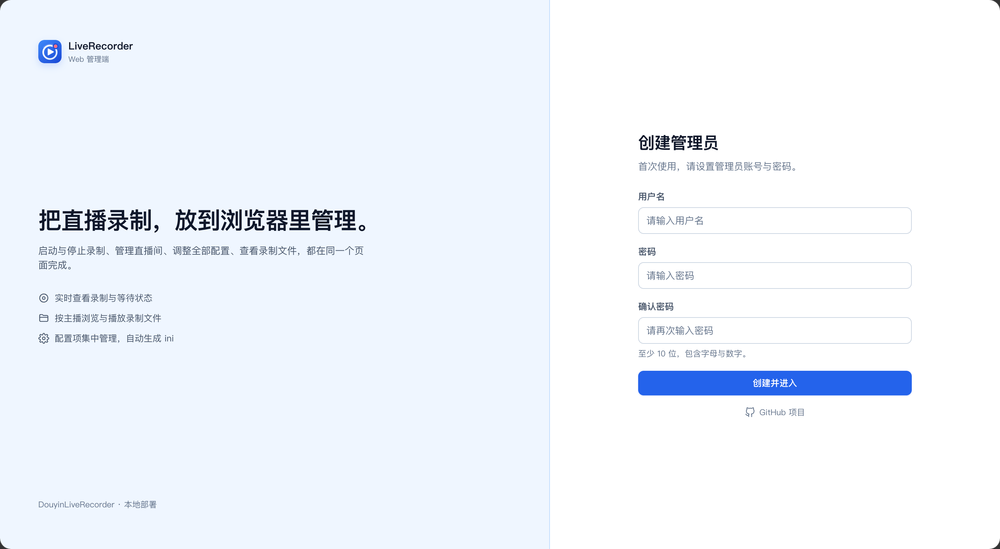
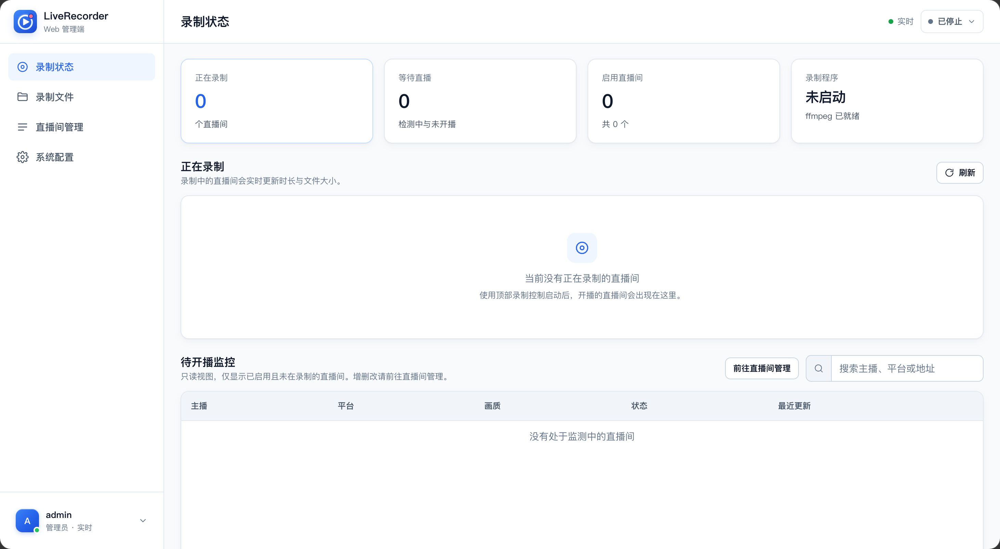
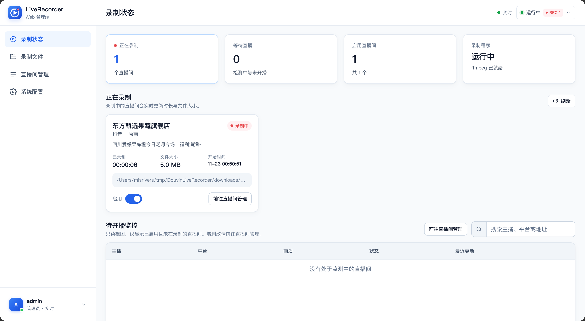
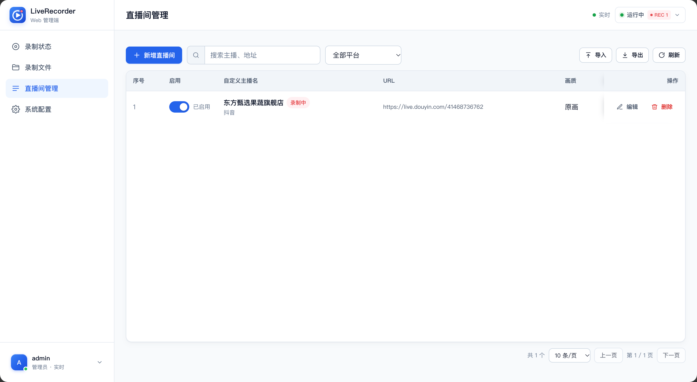
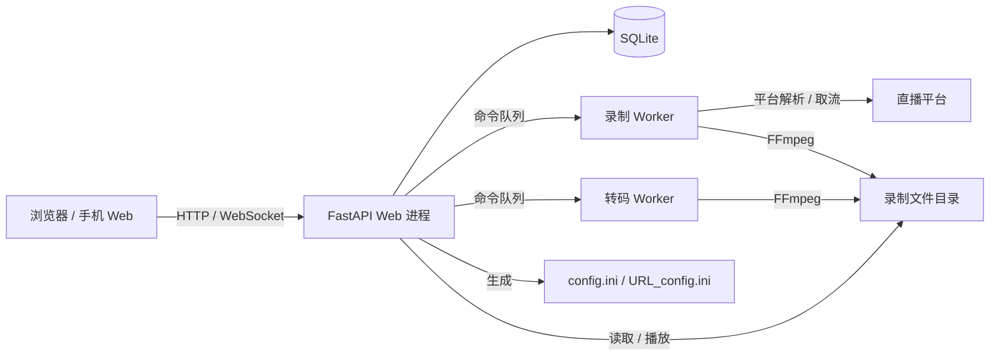

# LiveRecorder Web UI

GitHub 仓库：<https://github.com/MisRivers/DouyinLiveRecorder>

Docker 镜像：`misrivers/dlr-webui:latest`，支持 `linux/amd64` 与 `linux/arm64`。

一个面向自托管场景的直播录制管理端，基于 [ihmily/DouyinLiveRecorder](https://github.com/ihmily/DouyinLiveRecorder) 改造而来。它把原本依赖命令行、配置文件和循环值守的录制工具，变成可直接在浏览器和手机端使用的管理系统。

> **重要声明**：本项目仅用于个人学习、技术交流与自托管实验，不提供商业化录制、代录、内容分发或绕过平台限制的能力。直播内容版权归主播、平台或权利人所有，录制行为本身不代表获得授权。使用前请完整阅读[重要声明与合规使用](#重要声明与合规使用)，并自行确保行为符合平台服务条款与当地法律法规。

## 目录

- [重要声明与合规使用](#重要声明与合规使用)
- [功能概览](#功能概览)
- [界面预览](#界面预览)
- [技术栈](#技术栈)
- [系统架构](#系统架构)
- [目录结构](#目录结构)
- [快速开始](#快速开始)
- [使用说明](#使用说明)
- [配置项](#配置项)
- [Docker 部署](#docker-部署)
- [Windows EXE](#windows-exe)
- [版本更新](#版本更新)
- [安全加固建议](#安全加固建议)
- [数据、隐私与内容管理](#数据隐私与内容管理)
- [常见问题](#常见问题)
- [维护与支持](#维护与支持)
- [上游与许可](#上游与许可)
- [免责声明](#免责声明)

## 重要声明与合规使用

以下内容为使用风险提示，不构成法律意见。涉及具体权利义务时，请咨询专业律师。

### 项目定位

- 本项目是开源技术项目，用于个人学习、技术研究、自托管实验和自有直播内容的归档。
- 本项目不是直播平台、录播平台、内容分发平台或商业代录服务，也未获得任何直播平台的授权或背书。
- 本项目不提供平台账号、Cookie、付费内容、破解工具、去水印、DRM 绕过、地域限制绕过或任何规避技术措施的能力。
- 上游项目与抖音等平台无隶属关系；本仓库同样不是官方客户端。

### 允许的使用场景

- 录制自己拥有著作权的直播内容；
- 已取得主播或权利人明确授权的录制与归档；
- 在遵守平台服务条款的前提下，进行个人离线留存、技术研究与功能测试；
- 在本地或受控网络环境中学习 Web、FFmpeg、FastAPI、Vue 等技术。

### 明确禁止的用途

- 盗录、传播或售卖他人付费直播、会员内容、课程、演唱会、赛事等受保护内容；
- 绕过 DRM、加密、付费墙、地域限制、反爬或平台访问控制；
- 未经同意录制他人隐私场景，或公开他人肖像、住址、联系方式等个人信息；
- 批量抓取、自动化骚扰、跟踪、偷拍偷录或其他侵犯隐私权的行为；
- 将录制内容二次剪辑、公开传播、商业使用，或用于诽谤、敲诈、色情及其他违法用途；
- 将本项目包装为代录服务、内容站、下载站，或去除版权标识后对外分发；
- 任何违反平台服务条款、著作权法、个人信息保护法、网络安全法及当地法律的行为。

### 使用前合规清单

1. 确认你对目标直播拥有录制权，或已取得主播/权利人的明确授权；
2. 阅读并遵守目标平台的服务条款、robots 协议、API 规则与反爬政策；
3. 仅收集与录制目的直接相关的最少信息，不采集无关个人信息；
4. 为录制文件设置合理的保留期限，到期删除；
5. 不公开分享录制内容，不上传到公开网盘、视频站或社交平台；
6. 妥善保护 Cookie、Token、账号密码等敏感凭据；
7. 如需对外提供服务，先完成法律与合规评估；
8. 如当地法律要求告知或取得同意，请先履行相应程序。

### 责任边界

- 使用者应自行判断并承担使用本项目产生的一切法律与合规责任。
- 项目作者与贡献者不对任何录制内容、数据泄露、账号封禁、法律责任或间接损失负责。
- 本项目不托管、不代理、不分发任何直播或录制内容；所有文件均保存在使用者自己的设备上。
- 权利人如认为仓库中的示例、文档或截图侵犯其权利，可通过 GitHub Issue 联系处理；本项目会配合删除相关内容。
- 项目按“现状”提供，不提供任何明示或暗示担保，也不承诺持续维护或技术支持。

## 功能概览

### 录制状态

- 正在录制、等待直播、启用直播间、录制程序状态四张摘要卡；
- 录制卡片显示主播、平台、画质、标题、已录制时长、文件大小、当前文件；
- 录制控制位于顶部导航，任意页面都可以查看状态并启动、停止、重启；
- 支持“计划外”“平台已禁用”状态，避免无效检测；
- 支持“只推送不录制”模式：只检测开播/关播并发送通知，不启动 FFmpeg；
- 停止时区分优雅停止与强制停止，优雅停止会把 TS 加入转码队列；
- WebSocket 实时刷新，断线时自动回退轮询；
- 直播信号中断时自动重连，30 秒内恢复会继续本次录制；
- 显示 FFmpeg 缺失、Worker 心跳超时等异常提示。

### 直播间管理

- 新增、编辑、删除、启用/停用直播间；
- 支持快速填充平台 ID 或填写完整直播间地址；
- 支持批量导入、导出上游 `URL_config.ini` 格式；
- 支持搜索、平台筛选、分页，每页条数写入浏览器缓存；
- 从录制卡片跳转会定位到对应主播所在页，目标行高亮并显示“已定位”；
- 支持房间级每周录制计划，可设置多个时间段与跨天时段，时段外不检测、不录制；
- 停用正在录制的直播间会二次确认，优雅结束当前文件并转 MP4；
- 平台禁用后，其下直播间保留但暂停检测与录制。

### 录制文件

- 按主播分组浏览录制文件；
- 显示文件名、类型、大小、修改时间、转码状态；
- 支持按名称、修改时间、类型排序，排序写入浏览器缓存；
- 支持右键删除、批量勾选删除、批量转码；
- 内置播放器支持 MP4、M4A、MP3、FLV、TS；
- TS 使用 mpegts.js 播放，MP4 使用 HTML5 视频和统一自定义控制条；
- 支持在新标签页打开播放，新标签接管后自动关闭当前弹窗，避免两处同时播放；
- 播放弹窗自适应手机端。

### 通知与计划

- 通知模板覆盖开播、关播、开始录制、录制结束、转码完成、录制异常六类事件；
- 每类事件可独立开关、修改标题与正文，并插入运行时变量；
- 开播/关播通知只在启用“只推送不录制”时发送；正常录制使用开始录制与录制结束通知，避免重复提醒；
- 支持微信、钉钉、邮箱、Telegram、BARK、NTFY、PushPlus 等渠道；
- 发送失败会记录脱敏摘要，不会保存完整 Webhook 或 Token；
- 录制计划按星期配置，支持跨天时段与重叠校验。

### 系统配置

- 录制设置、推送配置、账号与授权、Cookie 管理四个分类；
- 配置项由元数据驱动，未知配置自动归入“上游新增”；
- 布尔、枚举、整数、浮点、多行文本、敏感值分别使用对应控件；
- 推送渠道支持多选，保存为逗号分隔字符串，兼容上游推送逻辑；
- 支持导出、导入 `config.ini`，保存后自动生成兼容文件；
- 刷新或关闭页面时，如果存在未保存修改会提示；
- 平台管理支持启用/禁用平台类型。

### 系统信息与账号

- 应用版本、上游版本、数据库大小、录制目录、配置目录；
- 数据库、磁盘、FFmpeg、Worker 心跳等环境检查；
- 运行日志查看与刷新；
- 修改管理员密码；
- 桌面端退出登录在左下角账号菜单，移动端在系统信息页。

## 界面预览

以下截图来自实际运行的管理端，桌面端浏览器宽度 1024px。

| 初始化管理员 | 录制状态 |
| --- | --- |
|  |  |

| 新增直播间 | 录制进行中 |
| --- | --- |
|  |  |

| 直播间管理 | 录制文件播放 |
| --- | --- |
|  |  |

## 技术栈

| 层次   | 技术                                                                |
| ---- | ----------------------------------------------------------------- |
| 前端   | Vue 3 `<script setup>`、Vite、Vue Router、原生 CSS 变量、mpegts.js、flv.js |
| 后端   | Python 3.11、FastAPI、Uvicorn、SQLite、WebSocket                      |
| 录制   | FFmpeg、上游平台解析与录制逻辑                                                |
| 进程模型 | Web 进程、录制 Worker、转码 Worker                                        |
| 部署   | Docker 多架构镜像（linux/amd64、linux/arm64）、Docker Compose              |
| 可选   | Windows EXE（PyInstaller，源码构建）                                       |

## 系统架构



核心设计：

- **SQLite 是运行期唯一事实来源**。设置、直播间、录制状态、转码任务、审计记录都写入 SQLite。
- **兼容文件是导出物**。`config/config.ini` 与 `config/URL_config.ini` 由系统按需生成，供人工查看、迁移和上游工具兼容。
- **Web 与录制分离**。Web 进程只负责 API 与 UI，录制和转码在独立 Worker 中运行，避免阻塞页面。
- **命令队列**。启动、停止、重启、转码等操作写入队列，由 Worker 消费，页面通过 WebSocket 或轮询获取状态。
- **多平台适配**。平台列表、URL 模板、画质选项由平台注册表统一维护，新增平台时不需要改页面结构。
- **多架构镜像**。同一个 `latest` 标签包含 amd64 与 arm64，NAS 和服务器拉取时自动匹配。

### 录制状态机

```text
stopped -> starting -> running -> stopping -> stopped
                         |
                         +-> error
```

单个直播间的状态包括：`disabled`、`checking`、`waiting`、`live`、`recording`、`stopping`、`error`、`scheduled`、`platform_disabled`。

## 目录结构

```text
DouyinLiveRecorder/
├── config/                     # 运行配置与兼容 ini（不入镜像）
├── data/                       # SQLite、密钥、缩略图、备份
├── downloads/                  # 录制文件
├── docs/                       # 技术设计与项目文档
├── src/                        # 上游平台解析与录制逻辑
├── webui/
│   ├── backend/
│   │   ├── routers/            # auth / live / rooms / files / settings / system / ws
│   │   ├── services/           # 业务服务
│   │   ├── workers/            # recorder_worker / converter_worker
│   │   ├── static/             # Vite 构建产物
│   │   ├── config.py           # 路径、端口、环境变量
│   │   ├── db.py               # SQLite、设置种子、ini 渲染
│   │   ├── main.py             # FastAPI 应用入口
│   │   └── settings_meta.py    # 配置元数据与分组
│   ├── frontend/
│   │   ├── src/views/          # Live / Files / Rooms / Settings / System / Login / Play
│   │   ├── src/components/     # AppShell、Player、RecorderControl、Modal 等
│   │   ├── src/styles.css      # 设计令牌与全局样式
│   │   └── vite.config.js
│   ├── Dockerfile
│   └── docker-entrypoint.sh
├── docker-compose.webui.yaml
├── run_webui.py
├── requirements.txt
└── webui/requirements.txt
```

## 快速开始

### 方式一：Docker（推荐）

公开镜像：

```text
misrivers/dlr-webui:latest
```

支持 `linux/amd64` 与 `linux/arm64`，同一标签自动匹配架构，NAS 无需登录 Docker。

```bash
docker pull misrivers/dlr-webui:latest
```

使用仓库内的 Compose 文件：

```bash
docker compose -f docker-compose.webui.yaml pull
docker compose -f docker-compose.webui.yaml up -d
```

默认访问地址：

```text
http://<服务器或 NAS 的 IP>:8642
```

首次打开会进入“创建管理员”页面，用户名至少 3 位，密码至少 10 位且必须同时包含字母和数字。

如需修改宿主机端口：

```bash
DLR_PORT=9000 docker compose -f docker-compose.webui.yaml up -d
```

### 方式二：本地 Python 运行

前置要求：

- Python 3.11+
- FFmpeg 与 ffprobe
- Node.js 20+（仅前端开发/构建需要）

```bash
python3.11 -m venv .venv
source .venv/bin/activate
pip install -r requirements.txt -r webui/requirements.txt
python run_webui.py --no-browser
```

默认访问 `http://127.0.0.1:8642`。确认 FFmpeg 可用：

```bash
ffmpeg -version
ffprobe -version
```

如果使用项目目录内的 FFmpeg，请放到 `ffmpeg/ffmpeg`（Windows 为 `ffmpeg/ffmpeg.exe`）。

如果从源码运行且之前没有构建过前端，需要先生成静态文件：

```bash
cd webui/frontend
npm install
npm run build
```

## 使用说明

### 1. 初始化与登录

首次访问会要求创建管理员。创建完成后自动登录。所有页面都需要登录，未登录会跳转到 `/login`。登录失败 5 次会锁定 15 分钟。

### 2. 顶部录制控制

录制控制位于顶部导航，任意页面都可以使用：

- 状态按钮显示“已停止 / 启动中 / 运行中 / 停止中 / 异常”；
- 有直播间在录制时显示 `REC N` 计数；
- 点击后展开录制控制面板，可启动录制、优雅停止、强制停止、重启引擎；
- 停止和重启在面板内二次确认，不会误触；
- 桌面端和手机端使用同一套控制逻辑。

### 3. 录制状态

“录制状态”页展示摘要卡、正在录制的直播间和等待开播列表。启动录制后，开播的直播间会自动出现在“正在录制”区域。计划外、平台禁用、磁盘不足等情况会显示对应状态。

### 4. 直播间管理

- 新增：选择平台，填写平台 ID 或完整链接，可在同一弹窗内设置录制计划（默认全天）；
- 编辑：修改平台、地址、画质、自定义主播名、启用状态；
- 录制计划：点击行内“计划”，按星期设置多个时间段；支持跨天时段，留空表示全天录制；
- 停用：正在录制的房间会先优雅收尾并转 MP4；
- 导入/导出：兼容上游 `URL_config.ini`；
- 从录制卡片跳转：自动定位到对应主播行，保留正常分页列表。

### 5. 录制文件

- 左侧选择主播，右侧查看文件；
- 点击“播放”打开弹窗，或使用“在新标签打开”；
- 在新标签打开后，当前弹窗会自动关闭；
- TS 文件可点击“转为 MP4”，批量勾选后可批量转码；
- 右键文件或主播可删除，删除前会二次确认。

### 6. 系统配置

四个分类标签：

- 录制设置：保存路径、格式、画质、分段、转码、代理、并发、磁盘阈值、自定义脚本；
- 推送配置：微信、钉钉、邮箱、TG、BARK、NTFY、PUSHPLUS 与推送文案；
- 账号与授权：各平台账号、Token、partner_code；
- Cookie 管理：按平台维护 Cookie。

保存后根据配置类型提示生效方式；需要重启的配置会显示提示。

“推送配置”页下方的“通知模板”区域提供六类事件，可分别开启并编辑标题与正文，正文支持 `{主播}`、`{平台}`、`{标题}`、`{时间}`、`{时长}`、`{文件大小}`、`{错误原因}` 等变量，发送渠道沿用“推送配置”中的选择。

通知事件按运行模式区分：

| 运行模式 | 发送的事件 |
| --- | --- |
| `只推送通知不录制 = 否` | 开始录制、录制结束、转码完成、录制异常 |
| `只推送通知不录制 = 是` | 开播、关播、拉流异常 |

开启“只推送通知不录制”后，录制引擎只检测直播状态，不启动 FFmpeg；关闭后恢复录制，并改用开始录制/录制结束通知，避免同一场直播同时收到开播和开始录制两条提醒。

“平台管理”用于平台类型启用/禁用。禁用后该平台不再出现在新增/编辑直播间列表中，已有直播间保留并显示“平台已禁用”，重新启用后自动恢复检测。

## 配置项

### 环境变量

| 变量                    | 默认值             | 说明                                 |
| --------------------- | --------------- | ---------------------------------- |
| `DLR_PORT`            | `8642`          | Web 服务端口                           |
| `DLR_HOST`            | `0.0.0.0`       | 监听地址                               |
| `DLR_DATA_DIR`        | `./data`        | SQLite、密钥、备份目录                     |
| `DLR_CONFIG_DIR`      | `./config`      | `config.ini` / `URL_config.ini` 目录 |
| `DLR_DOWNLOAD_DIR`    | `./downloads`   | 录制文件目录                             |
| `DLR_LOG_DIR`         | `./logs`        | 日志目录                               |
| `DLR_SECRET_KEY`      | 自动生成            | 会话密钥；未设置时写入 `data/secret.key`      |
| `DLR_LOG_LEVEL`       | `info`          | 日志级别                               |
| `DLR_TRUST_PROXY`     | 未设置             | 设为 `1` 时信任反向代理传入的 `X-Forwarded-For` |
| `DLR_DISABLE_WORKERS` | 未设置             | 设为 `1` 时只启动 Web，不启动录制/转码 Worker    |
| `PUID` / `PGID`       | `1000`          | Docker 运行用户与目录属主                   |
| `TZ`                  | `Asia/Shanghai` | 容器时区                               |

### 目录与持久化

| 容器路径             | 用途           | 建议    |
| ---------------- | ------------ | ----- |
| `/app/data`      | SQLite、密钥、备份 | 必须持久化 |
| `/app/config`    | 生成的 ini 与备份  | 建议持久化 |
| `/app/downloads` | 录制文件         | 必须持久化 |
| `/app/logs`      | 运行日志         | 建议持久化 |

### 关键行为配置

| 配置项 | 作用 | 注意事项 |
| --- | --- | --- |
| `只推送通知不录制(是/否)` | 只检测开播/关播并推送，不启动 FFmpeg | 开启后不会产生录制文件 |
| `循环时间(秒)` | 未开播房间的检测间隔，默认 300 秒 | 实际间隔会加入少量随机抖动 |
| `同一时间访问网络的线程数` | 并发取流上限，默认 3 | 过高可能触发平台风控 |
| `分段录制是否开启` | 按 `视频分段时间(秒)` 切分 | 部分平台强制走直连 FLV，不受此开关影响 |
| `录制完成后自动转为mp4格式` | 录制结束后把 TS 加入转码队列 | 需要额外 CPU 与磁盘空间 |
| `录制空间剩余阈值(gb)` | 低于阈值停止启动或中止录制 | 默认 1.0 GB，请按磁盘容量调整 |
| `自定义脚本执行命令` | 录制完成后执行脚本 | 以 argv 方式执行，不经过 shell |
| `使用代理录制的平台` | 仅对指定平台启用代理 | 海外平台通常需要代理 |
| 通知模板 | 六类事件独立开关与文案 | 默认关闭，需要手动启用 |
| 平台管理 | 平台类型启用/禁用 | 禁用不会删除直播间数据 |

## Docker 部署

### 镜像与架构

- 镜像：`misrivers/dlr-webui:latest`
- 架构：`linux/amd64`、`linux/arm64`
- 容器内端口：`8642`
- 健康检查：`GET /api/system/health`
- 镜像内置：FFmpeg、ffprobe、Node.js 运行时、前端静态文件

### 本地构建镜像

```bash
python scripts/check_build_files.py
docker buildx build \
  --platform linux/amd64,linux/arm64 \
  --build-arg APP_VERSION=1.1.0 \
  --build-arg DEBIAN_MIRROR=https://mirrors.tuna.tsinghua.edu.cn/debian \
  --build-arg DEBIAN_SECURITY_MIRROR=https://mirrors.tuna.tsinghua.edu.cn/debian-security \
  --build-arg PIP_INDEX_URL=https://pypi.tuna.tsinghua.edu.cn/simple \
  -f webui/Dockerfile \
  -t misrivers/dlr-webui:1.1.0 --push .
```

必须指定 `-f webui/Dockerfile`。国内镜像参数可按网络情况替换或删除。

### 发布流程（beta / stable）

仓库只保留统一发布工作流 `.github/workflows/release.yml`，通过 4 条命令发布：

```bash
bash scripts/release.sh beta docker
bash scripts/release.sh beta windows
bash scripts/release.sh release docker
bash scripts/release.sh release windows
```

- beta：版本形如 `1.1.0-beta.N`，Docker 推送 `beta` 与版本标签，Windows 更新滚动预发布 `webui-v1.1.0-beta`；
- stable：版本从最近正式标签自动递增，Docker 推送 `latest` 与版本标签；
- `release docker` 与 `release windows` 共享同一个草稿 Release，两端资产齐全后自动转为正式版；
- 构建前统一执行 `python scripts/check_build_files.py`，禁止把 `config/data/downloads/logs`、凭据与开发产物打入镜像或 EXE。

完整规则、产物命名和构建内容标准见 [RELEASE.md](RELEASE.md)。

需要在仓库 Secrets 中配置 `DOCKERHUB_USERNAME` 与 `DOCKERHUB_TOKEN`（兼容旧配置 `DOCKERHUB_PASSWORD`）。

### NAS 部署

1. 在 NAS 的 Docker 中拉取 `misrivers/dlr-webui:latest`；
2. 将 `docker-compose.webui.yaml` 上传到 NAS；
3. 按 NAS 的用户 ID 设置 `PUID` / `PGID`；
4. 修改端口映射（如需要）；
5. 启动容器，浏览器访问 `http://NAS_IP:8642`。

如果使用命令行：

```bash
docker compose -f docker-compose.webui.yaml pull
docker compose -f docker-compose.webui.yaml up -d
```

### Docker Compose 部署

仓库提供了 [docker-compose.webui.yaml](docker-compose.webui.yaml)，核心配置如下：

```yaml
services:
  dlr-webui:
    image: misrivers/dlr-webui:latest
    container_name: dlr-webui
    init: true
    ports:
      - "${DLR_PORT:-8642}:8642"
    environment:
      TZ: "Asia/Shanghai"
      DLR_PORT: "8642"
      PUID: "1000"
      PGID: "1000"
    volumes:
      - ./config:/app/config
      - ./downloads:/app/downloads
      - ./data:/app/data
      - ./logs:/app/logs
    restart: unless-stopped
    stop_grace_period: 60s
```

常用命令：

```bash
# 启动
docker compose -f docker-compose.webui.yaml up -d

# 查看日志
docker compose -f docker-compose.webui.yaml logs -f dlr-webui

# 更新镜像
docker compose -f docker-compose.webui.yaml pull
docker compose -f docker-compose.webui.yaml up -d

# 停止
docker compose -f docker-compose.webui.yaml down
```

部署要点：

- `8642` 是容器内固定端口，左侧是宿主机端口，可以按需修改；
- `PUID` / `PGID` 应与宿主机 `data`、`config`、`downloads`、`logs` 目录的属主一致；
- `data`、`config`、`downloads`、`logs` 必须挂载到宿主机，否则重建容器会丢失数据；
- 首次访问会进入管理员初始化页面；
- 停止容器前会预留 60 秒用于录制收尾与 TS 转 MP4；
- 不需要在 NAS 上登录 Docker Hub，镜像为公开镜像。

### 反向代理

如需通过域名访问，建议使用 Nginx、Caddy 或 Traefik 终止 HTTPS，并转发到 `127.0.0.1:8642`。注意：

- 转发 `/api/ws/events` 的 WebSocket 连接；
- 仅当代理可信时设置 `DLR_TRUST_PROXY=1`，否则不要信任 `X-Forwarded-For`；
- 建议限制访问来源（局域网、VPN、IP 白名单或额外认证）；
- 不要把管理端直接暴露在公网而不加任何防护。

### 备份、升级与迁移

需要备份的内容：

- `data/`：SQLite 数据库、密钥、备份；
- `config/`：生成的 `config.ini`、`URL_config.ini` 与导出备份；
- 如需保留录制内容，另外备份 `downloads/`。

升级步骤：

```bash
docker compose -f docker-compose.webui.yaml pull
docker compose -f docker-compose.webui.yaml up -d
```

数据库结构会在启动时自动迁移。跨大版本升级前，建议先停止容器并完整备份 `data/` 与 `config/`。

## Windows EXE

Windows 免安装版本由 GitHub Actions 构建，正式版资产为：

```text
DouyinLiveRecorderUI-<版本>-windows-x64.zip
```

测试版使用滚动资产 `DouyinLiveRecorderUI-windows-x64-beta.zip`，每次构建覆盖。

- 解压后运行 `DouyinLiveRecorderUI.exe`；
- 首次启动会检测 FFmpeg，缺失时弹出安装窗口，可自动下载 Windows 64 位版本并安装到 `ffmpeg/`；
- 自动下载优先使用国内 GitHub 加速镜像（gh-proxy.com / ghproxy.net），失败后回退 gyan.dev / BtbN；
- 也可手动从 <https://www.gyan.dev/ffmpeg/builds/> 下载，解压后把 `bin/ffmpeg.exe` 与 `bin/ffprobe.exe` 放入程序目录的 `ffmpeg/`；
- 已安装到系统 PATH 时不会提示；
- EXE 不内置 FFmpeg，自动下载需要网络连接。
- 构建只包含运行时代码、前端静态文件与 `VERSION`，不会包含 `config/data/downloads/logs`。

## 版本更新

- 版本唯一来源为根目录 [VERSION](VERSION)，发布时写入 Docker 镜像与 Windows 目录；
- beta 版本由发布工作流自动编号，Windows EXE 启动后会自动检查 GitHub Releases；
- Web 端“系统信息 → 版本更新”可手动检查并查看发行版说明；
- 检测到新版本时会提供发行版页面链接，不会自动替换程序文件；
- 发布通过 `bash scripts/release.sh release docker` 与 `bash scripts/release.sh release windows` 完成，标签前缀为 `webui-v`，Release 由工作流自动创建与发布；
- 如需提高 GitHub API 限额，可在运行环境设置 `DLR_GITHUB_TOKEN`。

## 安全加固建议

- 首次部署后立即修改管理员密码，使用至少 10 位、包含字母与数字的强密码；
- 管理端尽量只监听局域网或 VPN，不要直接暴露到公网；
- 必须公网访问时，使用 HTTPS 反向代理、访问控制与登录保护；
- 仅在使用可信反向代理时开启 `DLR_TRUST_PROXY`；
- 使用独立的系统用户与 `PUID` / `PGID` 运行，避免使用 root；
- 限制 `data/`、`config/`、`downloads/` 的目录权限，避免其他用户读取；
- 定期轮换平台 Cookie、Token 与推送 Webhook；
- 定期更新镜像与依赖，关注安全公告；
- 关注磁盘剩余空间，避免录制中断或转码失败；
- 定期检查审计日志、运行日志与登录失败记录；
- 不要在公开仓库、截图、Issue 或日志中暴露 Cookie、Token、密码与内网地址；
- 如需多用户使用，请先评估现有单管理员模型的权限边界，或等待后续版本。

## 数据、隐私与内容管理

### 本地保存的数据

- SQLite：管理员账号、会话、直播间、设置、录制状态、转码任务、审计记录、通知记录；
- `config/`：生成的 `config.ini` 与 `URL_config.ini`，可能包含明文 Cookie、Token、账号；
- `data/secret.key`：会话签名密钥；
- `logs/`：Web、录制、转码日志；
- `downloads/`：录制文件与字幕。

### 数据最小化与保留

- 只录入必要的直播间与账号信息；
- 为录制文件设定保留期限，定期清理不再需要的内容；
- 删除直播间不会自动删除历史录制文件，需要手动清理；
- 删除文件时会同时清理关联的转码任务记录与空目录；
- 卸载前请确认是否需要保留 `data/`、`config/` 与 `downloads/`。

### 隐私与访问控制

- 本系统默认不向任何云端服务上传数据；推送功能仅在配置后向指定 Webhook 发送通知；
- Cookie、Token 属于敏感凭据，泄露可能导致账号被登录或封禁；
- 截图、日志、Issue 中不要包含真实 Cookie、Token、手机号、邮箱或内网地址；
- 如录制内容涉及他人个人信息，请遵守个人信息保护相关法律，并设置更严格的访问控制与保留期限。

## 常见问题

### 页面打不开

- 确认容器或进程已启动；
- 检查 8642 端口是否被占用；
- NAS 上确认端口映射和防火墙；
- 查看 `logs/webui.log`。

### 提示未找到 ffmpeg

- Docker 镜像已内置 FFmpeg；
- 源码运行请安装 FFmpeg，或把二进制放到 `ffmpeg/`；
- 确认当前用户对 FFmpeg 有执行权限。

### 录制文件没有出现

- 检查设置中的保存路径；
- 在录制文件页点击“重新扫描目录”；
- 确认录制 Worker 正在运行；
- 检查磁盘剩余空间与目录权限。

### 手机端输入时页面放大

- 项目已设置移动端 viewport 禁止缩放；
- 移动端输入框使用 16px 字号，避免 iOS Safari 聚焦时自动放大；
- 如果仍然放大，请检查浏览器是否强制开启了“缩放”或“无障碍字号”。

### 没有收到通知

- 在“推送配置”选择渠道并填写参数，先用“发送测试”确认渠道可用；
- 确认对应事件的通知模板已开启；
- 开播/关播通知只在“只推送通知不录制 = 是”时发送；正常录制请检查“开始录制”和“录制结束”；
- 自建 Webhook 需使用受信任的 HTTPS 证书，证书链不完整会导致发送失败；
- 在系统信息页查看运行日志，通知发送失败会记录脱敏后的渠道摘要。

### WebSocket 显示轮询

- 反向代理需要转发 WebSocket；
- 检查 `/api/ws/events` 是否可达；
- 页面会自动回退到轮询，不影响基本使用。

### 容器权限问题

- 设置 `PUID` / `PGID` 与宿主机目录属主一致；
- 确认 `data`、`config`、`downloads`、`logs` 可写；
- 初次启动会对挂载目录执行属主修正，大目录可能耗时。

### 可以录制他人的直播吗？

不能仅凭“公开可见”就认为可以录制。公开直播同样可能受著作权、肖像权、隐私权与平台条款保护。请仅在取得授权、属于合理使用范围或法律明确允许的情况下录制，并遵守平台规则。

### 项目会把数据上传到云端吗？

不会。系统默认只在本机运行，数据保存在本地 SQLite、配置文件和录制目录中。只有你主动配置的推送渠道会接收通知内容。

### 如何只允许局域网访问？

- 用防火墙限制 8642 端口只允许内网网段；
- 或绑定到内网地址并配合 VPN；
- 不要在没有额外保护的情况下做公网端口映射。

### 如何彻底删除数据？

停止容器后删除 `data/`、`config/`、`downloads/`、`logs/` 即可。删除前请确认已完成备份，且不再需要其中的录制内容。

## 维护与支持

- 本项目由个人维护，按“尽力而为”原则处理 Issue 与改进建议，不提供 SLA、商业支持或法律咨询；
- 提交问题前请先搜索历史 Issue，并提供可复现步骤、运行环境与脱敏后的日志；
- 安全漏洞请通过私下渠道联系维护者，不要在公开 Issue 中披露敏感细节；
- 不接受任何绕过平台限制、破解、盗录或侵犯隐私的功能请求；
- 项目可能因上游接口变化、平台风控或法律要求而调整功能或停止维护。

## 上游与许可

本项目基于 [ihmily/DouyinLiveRecorder](https://github.com/ihmily/DouyinLiveRecorder) 改造，保留其平台解析、录制与 FFmpeg 相关能力。上游项目采用 MIT License，Copyright (c) 2025 Hmily。

本仓库新增的 Web UI、后端管理、Docker 与文档代码同样遵循 MIT License，详见 [LICENSE](LICENSE)。

使用、修改或分发本项目时，请保留原始版权声明与许可文本，并自行承担合规责任。

## 免责声明

本项目及文档仅用于技术学习、研究与自托管实验，不构成任何形式的授权、许可或法律意见。项目作者与贡献者不拥有直播内容的相关权利，也不对使用者的录制、存储、传播或商业使用行为负责。

使用者应自行确保：

- 已获得录制、存储与使用相关内容所需的全部授权；
- 行为符合目标平台的服务条款、API 规则与反爬政策；
- 行为符合著作权法、个人信息保护法、隐私权、肖像权及当地其他法律法规；
- 录制内容仅用于合法目的，并采取必要的访问控制与保留期限管理。

因使用或无法使用本项目而产生的任何直接或间接损失、法律责任、账号封禁、数据泄露或第三方索赔，项目作者与贡献者均不承担责任。项目按“现状”提供，不提供任何明示或暗示担保。

如权利人认为本项目中的示例、文档或截图侵犯其合法权益，请通过 GitHub Issue 联系，本项目会配合处理。
